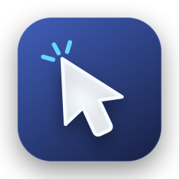

# Pointer

SwiftUI utility for replacing 19 macOS system cursors with animated GIF and Windows ANI designs.

[Download v1 for macOS](https://github.com/Ajtn05/Pointer/releases/download/v1/Pointer-macOS.zip) · [All releases](https://github.com/Ajtn05/Pointer/releases)

macOS 14 or later · Apple Silicon and Intel · Ad hoc signed

## Usage

Select a cursor type, open or drop in a `.gif` or `.ani`, set its size and hotspot, and click **Apply**. **Run in Background** keeps custom cursors active and moves the controls to the menu bar.

Pointer uses private WindowServer cursor APIs. For system playback, animations are limited to 24 equally timed frames and resampled as needed.

## Build

Requires Swift 6 or later.

```sh
make run
swift test
```
